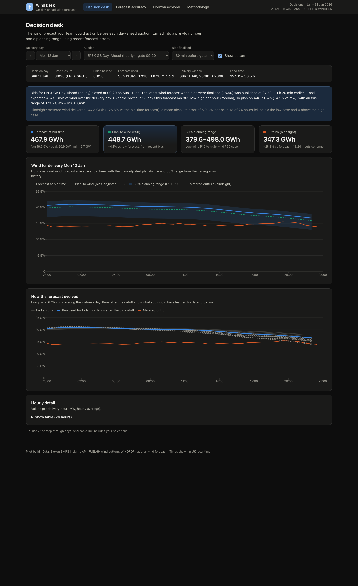
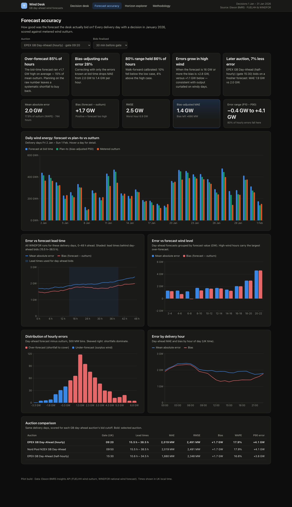

# Wind Desk — day-ahead wind forecast decision support (GB)

A pilot web app for a UK energy supplier's day-ahead trading desk. It answers two questions for every
purchase decision made in **January 2026**:

1. **What was the latest national wind forecast available when we had to bid?**
2. **How accurate is that forecast, and how should the error change what we buy?**

**Live app:** https://ztfhqn.vercel.app  ·  **API docs (OpenAPI):** https://ztfhqn.vercel.app/api/docs

| Decision desk | Forecast accuracy |
| --- | --- |
|  |  |

---

## What it does

| View | Purpose |
| --- | --- |
| **Decision desk** | Pick a delivery day and auction. Shows the exact WINDFOR run available before bids closed, a bias-adjusted *plan-to* number (P50), an 80% planning range (P10–P90), how the forecast evolved run by run, and — in hindsight — what was actually metered. |
| **Forecast accuracy** | Backtest of every January decision: MAE, RMSE, bias, WAPE, error distribution, error by lead time / wind level / hour of day, calibration of the planning range, and a comparison of the three GB day-ahead auctions. |
| **Horizon explorer** | For any date range, outturn vs. the latest forecast made at least *H* hours ahead (slider 0–48 h). |
| **Methodology** | Plain-English definitions, assumptions and limitations. |

### Headline findings (decisions 1–31 Jan 2026, EPEX hourly auction, bids 30 min before 09:20 gate)

- The bid-time forecast **over-stated wind in 85% of hours**, by **+1.7 GW on average** (≈15% of mean outturn).
  MAE 2.0 GW, RMSE 2.5 GW.
- Correcting with only errors **already known at bid time** (walk-forward, trailing 28 days) cuts **MAE by 28%** (2.0 → 1.4 GW).
- The walk-forward **80% planning range contained the outturn in 86% of hours** (slightly conservative).
- Over-forecasting grows with wind level (+2.8 GW when the forecast is ≥ 16 GW vs +1.1 GW below) — consistent with
  curtailment of wind on windy days, which metered FUELHH output reflects but the forecast does not.
- Bidding in the **15:30 half-hourly auction** uses a fresher forecast and has **7% lower MAE** than the 09:20/09:50 auctions.

## Quick start

### Docker (recommended)

```bash
docker compose up --build
```

Open http://localhost:8080 (API at http://localhost:8000/api/docs).

### Local development

Prerequisites: Python 3.12 + [uv](https://docs.astral.sh/uv/), Node 22+.

```bash
# Backend (FastAPI) on :8000
cd backend
uv sync
uv run uvicorn main:app --reload --port 8000

# Frontend (Vite + React) on :5173, proxies /api to :8000
cd frontend
npm install
npm run dev
```

### Tests and checks

```bash
cd backend  && uv run pytest && uv run ruff check . && uv run mypy winddesk   # 81 tests, ~98% coverage
cd frontend && npm test && npm run lint && npm run typecheck && npm run build  # 44 tests, ~88% line coverage
```

### Refresh the data snapshot from Elexon

```bash
cd backend && uv run python -m scripts.build_snapshot
```

Set `WINDDESK_DATA_SOURCE=elexon` to load live from the Elexon API at startup instead (falls back to the bundled
snapshot if the API is unavailable). All settings are listed in [`.env.example`](.env.example).

## Repository layout

```
.
├── backend/                     Python 3.12 · FastAPI · pandas
│   ├── main.py                  ASGI entrypoint (uvicorn / Vercel)
│   ├── winddesk/
│   │   ├── config.py            Settings from environment variables (validated)
│   │   ├── api/                 HTTP layer: app factory, routes, response schemas, middleware
│   │   ├── services/            Use cases: backtest, decision view, accuracy report, explorer
│   │   ├── domain/              Pure logic: markets & gate closures, forecast selection, metrics, error bands
│   │   └── data/                Elexon BMRS client and snapshot / live repository
│   ├── data/                    Versioned snapshot (FUELHH wind + WINDFOR, Dec 2025 – Feb 2026) + manifest
│   ├── scripts/build_snapshot.py  Re-downloads the snapshot from Elexon
│   ├── tests/                   unit/ (domain, data, services) and integration/ (HTTP API)
│   ├── pyproject.toml, uv.lock  Dependencies and tool config (ruff, mypy, pytest, coverage)
│   └── Dockerfile
├── frontend/                    React 19 · TypeScript · Vite · Recharts · TanStack Query
│   ├── src/
│   │   ├── api/                 Typed API client, response types, query hooks
│   │   ├── features/            decision/, accuracy/, explorer/, method/ — one folder per view
│   │   ├── components/          Shared UI: layout, cards, tiles, legend, tooltip, states
│   │   ├── lib/                 Formatting, UK-time helpers, axis scales, URL state, palette
│   │   └── test/                Test setup and fixtures
│   ├── nginx.conf, Dockerfile   Production container (static SPA + /api reverse proxy)
│   └── vite.config.ts           Dev proxy, build chunks, Vitest config
├── docs/
│   ├── architecture.md          Design, data flow, key decisions and trade-offs
│   └── screenshots/
├── docker-compose.yml           api + web
├── vercel.json                  Vercel Services: frontend + FastAPI in one deployment
├── .github/workflows/ci.yml     Lint, type-check, test (coverage gates) and Docker build
└── .env.example                 All configuration knobs
```

## API

| Endpoint | Description |
| --- | --- |
| `GET /api/health` | Liveness + dataset size |
| `GET /api/meta` | Decision window, delivery dates, auctions, defaults |
| `GET /api/decision?deliveryDate=2026-01-12&market=epex-hourly&bidLeadMinutes=30` | Bid-time forecast, band, outturn, forecast vintages |
| `GET /api/accuracy?market=epex-hourly&bidLeadMinutes=30` | Backtest metrics and breakdowns |
| `GET /api/explorer?start=…&end=…&minHorizonH=24` | Outturn vs latest forecast ≥ H hours ahead |

Interactive docs: `/api/docs`.

## Key modelling choices

- **Decision timing.** GB day-ahead auctions trade 23:00→23:00 UK delivery days. Gate closures: EPEX hourly 09:20,
  Nord Pool N2EX 09:50, EPEX half-hourly 15:30 (UK time, D-1). Bids are finalised a configurable lead time before gate
  (default 30 min); the forecast used is the latest WINDFOR run published strictly before that cutoff.
- **Scope.** Decisions 1–31 Jan 2026 → delivery days 2 Jan – 1 Feb. December 2025 is loaded only as error history so
  the first January decisions have a planning range.
- **Error** = forecast − outturn, at each hourly forecast target vs. the FUELHH settlement period with the same
  `startTime`. Positive = forecast too high (shortfall to buy back).
- **Planning range** from walk-forward empirical quantiles of past errors — no future information leaks into a decision.

See [docs/architecture.md](docs/architecture.md) and the in-app Methodology page for details and limitations.

## Deployment

Deployed on **Vercel** using [Services](https://vercel.com/docs) (`vercel.json`): the Vite build serves the SPA and the
FastAPI app serves `/api/*` from the same origin, shipped atomically. Responses are CDN-cacheable because the served
data is immutable per deployment.

```bash
vercel deploy --prod
```

## Use of AI tools

This project was built with the help of **AI coding assistants (Anthropic Claude, via Claude Code)**, used for
domain research (GB day-ahead market timings, dataset behaviour), scaffolding, implementation, tests, documentation and
review. All analysis choices, numbers and code were checked by running the test suites and inspecting the data and
the deployed app.

## Data source

Elexon BMRS Insights API — [FUELHH](https://bmrs.elexon.co.uk/api-documentation/endpoint/datasets/FUELHH/stream) and
[WINDFOR](https://bmrs.elexon.co.uk/api-documentation/endpoint/datasets/WINDFOR/stream). Contains BMRS data © Elexon
Limited copyright and database right 2026.
